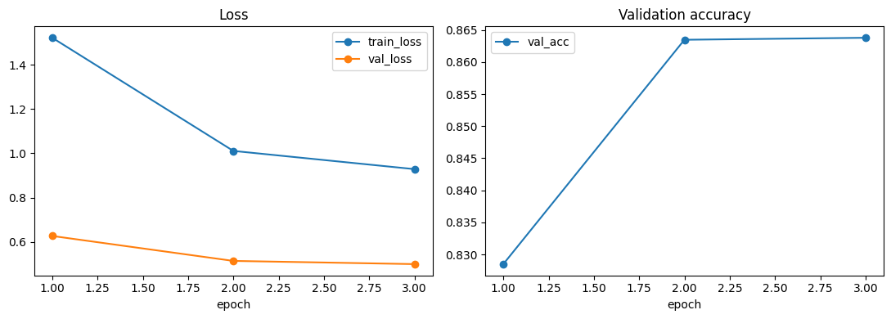
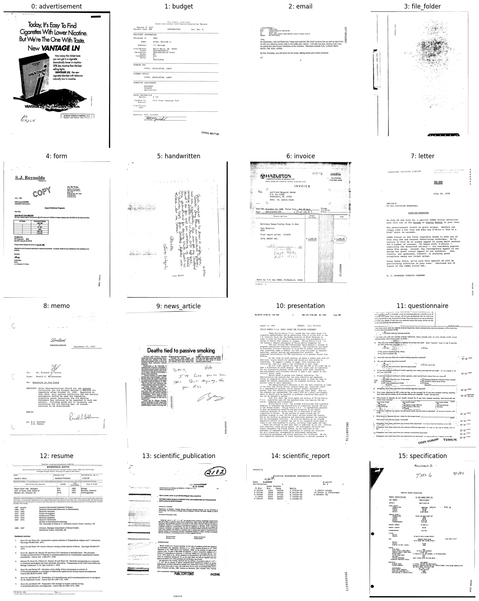
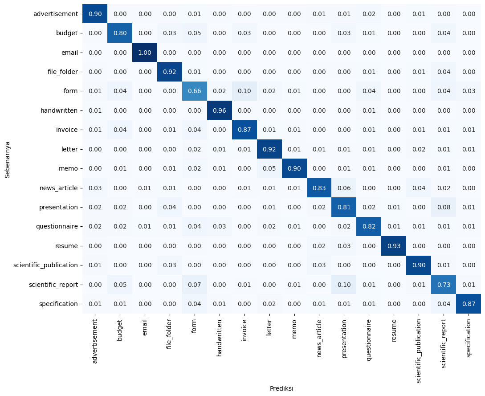

# Klasifikasi Citra Dokumen (RVL-CDIP subset, 16 Kelas)

Proyek klasifikasi gambar dokumen hasil pindai ke 16 kategori (advertisement, budget, email, file_folder, form, handwritten, invoice, letter, memo, news_article, presentation, questionnaire, resume, scientific_publication, scientific_report, specification) untuk kompetisi Kaggle **[Document Image Classification](https://www.kaggle.com/competitions/document-image-classification-sd234504)**. Metrik: *Categorical Accuracy*.

Pendekatan: **fine-tuning Vision Transformer DiT-base** (`microsoft/dit-base`, pre-trained self-supervised pada dokumen IIT-CDIP) menggunakan **PyTorch**, dengan gambar di-*cache* sebagai array grayscale 224x224 agar training cepat.

## Hasil

| Metrik | Nilai |
|---|---|
| Akurasi validasi (10% data latih, stratified) | **86,38%** |
| Macro F1 validasi | 0,864 |
| Waktu training (3 epoch, GPU T4) | ~14 menit |
| Public score (leaderboard) | _isi setelah submit_ |
| Private score (leaderboard) | _isi setelah kompetisi selesai_ |

| Epoch | Train loss | Val loss | Val acc |
|---|---|---|---|
| 1 | 1,5217 | 0,6266 | 82,85% |
| 2 | 1,0107 | 0,5139 | 86,35% |
| 3 | 0,9284 | 0,4995 | 86,38% |



## Struktur Repository

```
.
├── README.md
├── requirements.txt
├── .gitignore               # mengabaikan data/, checkpoint/, outputs/
├── assets/                  # gambar untuk laporan (distribusi kelas, contoh, kurva, confusion matrix)
├── data/                    # (tidak di-commit) letakkan dataset di sini
├── checkpoint/              # (tidak di-commit) bobot model best.pt
├── outputs/                 # (tidak di-commit) cache, history.csv, submission.csv
├── notebooks/
│   ├── 01_eda.ipynb         # eksplorasi data
│   ├── 02_training.ipynb    # training / fine-tuning
│   └── 03_evaluation.ipynb  # evaluasi + submission
└── src/                     # versi modular dari kode di notebook
    ├── config.py            # path, kelas, hyperparameter
    ├── data.py              # baca gambar, cache, Dataset, DataLoader
    ├── model.py             # DiT-base + head 16 kelas
    ├── train.py             # loop training (python -m src.train)
    ├── evaluate.py          # evaluasi validasi (python -m src.evaluate)
    ├── predict.py           # prediksi test + submission (python -m src.predict)
    └── utils.py             # seed, confusion matrix
```

Notebook ditulis berdiri sendiri (fungsi inti disertakan di dalamnya) agar bisa langsung dijalankan di Kaggle. Folder `src/` berisi kode yang sama dalam bentuk modul dengan docstring, untuk dijalankan dari command line.

## Cara Mengunduh Data

Dataset tidak disertakan di repo (ukurannya besar dan di-ignore oleh git).

1. Buka halaman kompetisi, login, lalu klik **Join Competition** dan setujui aturan.
2. Pilih salah satu:
   - **Browser:** tab *Data* -> *Download All*, lalu ekstrak `train.zip` dan `test.zip`.
   - **Kaggle CLI** (perlu `kaggle.json` dari *Account -> Create New API Token*):
     ```bash
     pip install kaggle
     kaggle competitions download -c document-image-classification-sd234504
     ```
3. Letakkan ke folder `data/` sehingga strukturnya:
   ```
   data/
   ├── train.csv  test.csv  sample_submission.csv
   ├── train/train/<nama_kelas>/*.tif     (atau train/<nama_kelas>/*.tif)
   └── test/test/test_xxxxx.tif           (atau test/test_xxxxx.tif)
   ```
   Kedua pola folder didukung oleh `resolve_path`.

Di Kaggle Notebook, data tidak perlu diunduh: klik **Add Input -> Competition** lalu pilih kompetisi ini.

## Cara Menjalankan

### Opsi A - Kaggle Notebook (disarankan, GPU gratis)
1. Buat notebook baru, impor `notebooks/01_eda.ipynb`, `02_training.ipynb`, dan `03_evaluation.ipynb`.
2. Di setiap notebook: **Add Input -> Competition** -> `document-image-classification-sd234504`.
3. Untuk notebook 02 dan 03: **Settings -> Accelerator -> GPU T4**, dan **Internet On** (mengunduh bobot DiT dari Hugging Face). Keduanya butuh verifikasi nomor telepon di akun Kaggle.
4. Jalankan berurutan:
   - `01_eda` (CPU cukup)
   - `02_training` -> **Save Version -> Save & Run All** agar `best.pt` dan cache tersimpan sebagai output
   - `03_evaluation` -> **Add Input -> Notebooks** -> pilih output notebook 02, lalu jalankan sampai selesai
5. Unduh `submission.csv` dari panel *Output* dan kirim lewat **Submit Predictions**.

### Opsi B - Lokal (command line, butuh GPU NVIDIA)
```bash
git clone <url-repo-ini> && cd <nama-repo>
python -m venv .venv
.venv\Scripts\activate            # Linux/Mac: source .venv/bin/activate
pip install -r requirements.txt   # untuk GPU, pasang PyTorch CUDA dari pytorch.org
# letakkan dataset di data/ (lihat bagian unduh data)

python -m src.train      # menyimpan checkpoint/best.pt dan outputs/history.csv
python -m src.evaluate   # laporan per kelas + outputs/confusion_matrix.png
python -m src.predict    # menulis outputs/submission.csv
```
Di CPU, training DiT-base sangat lambat (ratusan menit per epoch), jadi GPU sangat disarankan.

## Workflow Analisis

1. **EDA** (`01_eda`): struktur data, distribusi kelas, contoh visual, dan cek file terpotong.
2. **Preprocessing:** gambar TIFF -> grayscale -> resize 224x224 -> di-cache sebagai array uint8; normalisasi mean 0,5 dan std 0,5, diulang ke 3 channel.
3. **Pemodelan** (`02_training`): DiT-base pre-trained + head baru 16 kelas, seluruh bobot di-*fine-tune*.
4. **Training:** AdamW (lr 3e-5, weight decay 0,05), OneCycleLR, label smoothing 0,1, mixed precision, augmentasi geser acak kecil, 3 epoch, batch 32. Validasi stratified 90:10 (seed 42), bobot terbaik disimpan.
5. **Evaluasi** (`03_evaluation`): akurasi, laporan per kelas, confusion matrix, dan analisis kesalahan.
6. **Inferensi:** prediksi `argmax` pada test set -> `submission.csv` (format `id,label`).

## Laporan Interpretasi

### Data (EDA)
- 32.003 gambar latih dan 7.994 gambar uji. Kelas **sangat seimbang** (1.948 - 2.056 per kelas), sehingga tidak perlu *class weighting* dan akurasi cukup adil sebagai metrik.
- Citra berupa pindaian grayscale berorientasi potret dengan noise dan kualitas rendah. Hanya 1 file latih yang terpotong (32.768 byte) dan 0 di test; file tersebut ditangani agar training tidak berhenti.
- Train dan test punya median ukuran file yang mirip (~100 KB), menandakan distribusi serupa.



### Training
- Akurasi validasi naik dari 82,85% (epoch 1) ke 86,35% (epoch 2), lalu hampir datar di epoch 3 (86,38%). Saat learning rate turun di akhir OneCycle, peningkatan mengecil, sehingga menambah epoch dengan konfigurasi yang sama kemungkinan hanya memberi sedikit tambahan.
- Tidak ada tanda overfitting: val loss terus turun (0,63 -> 0,50). Train loss lebih tinggi dari val loss karena dihitung saat training dengan label smoothing dan augmentasi, serta dirata-rata ketika bobot masih berubah.

### Evaluasi per kelas
- **Terbaik (F1):** *email* 0,988, *resume* 0,954, *handwritten* 0,942, *memo* 0,925. Kelas ini punya ciri visual khas (kepala surel, struktur CV, tulisan tangan, judul MEMORANDUM).
- **Terlemah (F1):** *form* 0,677, *scientific_report* 0,721, *presentation* 0,778.
- **Kesalahan terbanyak:** *form* diprediksi *invoice* (20), *scientific_report* diprediksi *presentation* (19), *presentation* diprediksi *scientific_report* (15), *scientific_report* diprediksi *form* (14).
- Penafsiran (dugaan): *form* tertukar dengan *invoice* dan *budget* karena sama-sama berisi tabel dan kolom isian; *scientific_report* dan *presentation* tertukar karena sama-sama halaman teks padat dengan struktur judul dan poin yang mirip pada resolusi rendah.



### Keterbatasan dan perbaikan
- Resize ke 224x224 menghilangkan detail teks kecil, padahal beberapa kelas dibedakan oleh kata kunci. Skor test perlu dibandingkan dengan akurasi validasi 86,38% untuk menilai generalisasi.
- Ide lanjutan: resolusi lebih tinggi, test-time augmentation, ensemble model, dan fitur teks dari OCR.

## Referensi
- Harley et al., *Evaluation of Deep Convolutional Nets for Document Image Classification* (RVL-CDIP), 2015.
- Li et al., *DiT: Self-supervised Pre-training for Document Image Transformer*, 2022.
