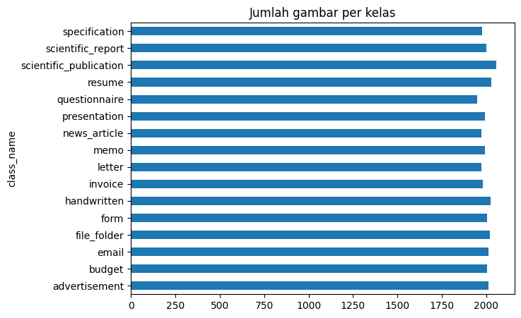

# Document Image Classification
Kompetisi Kaggle **[Document Image Classification](https://www.kaggle.com/competitions/document-image-classification-sd234504)**. 
Kategori yang digunakan meliputi advertisement, budget, email, file_folder, form, handwritten, invoice, letter, memo, news_article, presentation, questionnaire, resume, scientific_publication, scientific_report, dan specification.
Pendekatan yang digunakan adalah **fine-tuning Vision Transformer DiT-base** (`microsoft/dit-base`), yaitu model yang telah melalui pre-training self-supervised pada dokumen IIT-CDIP. Implementasi menggunakan PyTorch dengan preprocessing gambar grayscale berukuran 224 × 224.

## Hasil
| Metrik | Nilai |
|---|---:|
| Akurasi validasi (10% data latih, stratified) | **86,38%** |
| Macro F1 validasi | **0,864** |
| Waktu training (3 epoch, GPU T4) | ~14 menit |

### Training Performance
| Epoch | Train Loss | Val Loss | Val Accuracy |
|---|---:|---:|---:|
| 1 | 1,5217 | 0,6266 | 82,85% |
| 2 | 1,0107 | 0,5139 | 86,35% |
| 3 | 0,9284 | 0,4995 | 86,38% |


## Struktur Repository
Repository disusun berdasarkan tahapan pengerjaan, mulai dari penyimpanan data, eksplorasi, training, hingga evaluasi model.
```text
Document-Image-Classification/
│
├── data/
│   └── .gitkeep
│
├── notebooks/
│   ├── 01_eda.ipynb
│   ├── 02_training.ipynb
│   └── 03_evaluation.ipynb
│
├── outputs/
│   ├── .gitkeep
│   ├── confusion_matrix.png
│   ├── history.csv
│   ├── submission.csv
│   └── test_probs.npy
│
├── reports/
│   ├── class_distribution.png
│   ├── confusion_matrix.png
│   ├── samples_per_class.png
│   └── training_curves.png
│
├── scripts/
│   ├── __init__.py
│   ├── config.py
│   ├── data.py
│   ├── evaluate.py
│   ├── model.py
│   ├── predict.py
│   ├── train.py
│   └── utils.py
│
├── .gitignore
├── README.md
└── requirements.txt
```

### Penjelasan Folder dan File
| Folder/File | Fungsi |
|---|---|
| `data/` | Tempat menyimpan dataset train dan test. Dataset tidak disertakan di repository karena ukurannya besar. |
| `notebooks/` | Berisi notebook untuk setiap tahapan eksperimen. |
| `outputs/` | Menyimpan hasil eksperimen berupa training history, confusion matrix, probabilitas prediksi, dan submission. |
| `reports/` | Menyimpan visualisasi hasil EDA dan evaluasi untuk dokumentasi project. |
| `scripts/` | Berisi implementasi modular Python untuk konfigurasi, preprocessing, pemodelan, training, evaluasi, prediksi, dan utilitas. |
| `requirements.txt` | Daftar library Python yang dibutuhkan untuk menjalankan project. |
| `.gitignore` | Mengatur file dan folder yang tidak perlu disertakan dalam Git. |
| `README.md` | Dokumentasi project, metode, hasil, dan petunjuk penggunaan. |

File `.gitkeep` digunakan untuk mempertahankan folder kosong agar tetap terlihat di GitHub.

## Cara Mengunduh Dataset
Dataset tidak disertakan dalam repository karena ukurannya besar.
1. Buka [Kaggle Document Image Classification](https://www.kaggle.com/competitions/document-image-classification-sd234504).
2. Login, klik **Join Competition**, dan setujui aturan kompetisi.
3. Unduh dataset melalui tab Data atau menggunakan Kaggle CLI.
Menggunakan Kaggle CLI:
```bash
pip install kaggle
kaggle competitions download -c document-image-classification-sd234504
```

4. Ekstrak dataset dan letakkan di dalam folder `data/`.
Struktur dataset yang digunakan:
```text
data/
├── train.csv
├── test.csv
├── sample_submission.csv
├── train/
│   └── train/
│       └── <nama_kelas>/
│           └── *.tif
└── test/
    └── test/
        └── test_xxxxx.tif
```
Notebook juga mendukung variasi struktur folder dataset yang disediakan oleh kompetisi.
Pada Kaggle Notebook, dataset dapat langsung ditambahkan melalui **Add Input → Competition** tanpa perlu mengunduh secara manual.

## Cara Menjalankan Project
### Kaggle Notebook (Disarankan)
Training dilakukan menggunakan GPU T4 pada Kaggle Notebook.
1. Buat notebook baru di Kaggle.
2. Tambahkan dataset melalui **Add Input → Competition**.
3. Impor notebook dari folder `notebooks/`.
4. Jalankan notebook sesuai urutan berikut:

| Notebook | Tahapan |
|---|---|
| `01_eda.ipynb` | Eksplorasi dan visualisasi data |
| `02_training.ipynb` | Preprocessing dan training model |
| `03_evaluation.ipynb` | Evaluasi dan pembuatan submission |

Untuk notebook training dan evaluasi:
- Atur accelerator ke GPU T4.
- Aktifkan Internet untuk mengunduh pre-trained weights dari Hugging Face.
- Jalankan training hingga selesai dan simpan hasil melalui Save Version.
- Gunakan output training sebagai input untuk notebook evaluasi.
Setelah evaluasi selesai, unduh `submission.csv` dan unggah melalui menu **Submit Predictions** pada kompetisi Kaggle.

## Workflow Analisis dan Pemodelan
1. **Exploratory Data Analysis (EDA)**
   Memeriksa struktur dataset, distribusi kelas, contoh citra, serta kualitas file gambar.
2. **Preprocessing**
   Gambar TIFF dikonversi menjadi grayscale, diubah ukurannya menjadi 224 × 224, kemudian disimpan dalam bentuk array uint8 untuk mempercepat proses training. Selanjutnya dilakukan normalisasi dengan mean 0,5 dan standard deviation 0,5, serta konversi ke 3 channel.
3. **Pemodelan**
   Menggunakan Vision Transformer DiT-base pre-trained dengan classification head baru untuk memprediksi 16 kelas dokumen.
4. **Training**
   Fine-tuning dilakukan menggunakan AdamW dengan learning rate 3e-5, weight decay 0,05, OneCycleLR, label smoothing 0,1, mixed precision, dan augmentasi berupa pergeseran acak kecil.
   Training berlangsung selama 3 epoch dengan batch size 32. Pembagian data validasi menggunakan stratified split 90:10 dengan seed 42.
5. **Evaluasi**
   Model dievaluasi menggunakan accuracy, macro F1-score, classification report, dan confusion matrix.
6. **Prediksi**
   Model menghasilkan prediksi pada test set menggunakan argmax dari probabilitas kelas. Hasilnya disimpan dalam format `submission.csv` dengan kolom `id` dan `label`.

## Hasil dan Interpretasi
### Exploratory Data Analysis
- Dataset terdiri dari 32.003 gambar latih dan 7.994 gambar uji.
- Distribusi kelas relatif seimbang, dengan jumlah sekitar 1.948–2.056 gambar per kelas.
- Citra berupa dokumen hasil pindai grayscale dengan orientasi potret, noise, dan kualitas gambar yang bervariasi.
- Terdapat satu file gambar latih yang terpotong dan tidak ditemukan file serupa pada data test.




### Training
Akurasi validasi meningkat dari 82,85% pada epoch pertama menjadi 86,35% pada epoch kedua, kemudian mencapai 86,38% pada epoch ketiga.
Validation loss juga mengalami penurunan dari 0,6266 menjadi 0,4995. Hasil ini menunjukkan bahwa model mengalami peningkatan performa selama proses training tanpa indikasi overfitting yang jelas berdasarkan metrik validasi tersebut.

### Evaluasi per Kelas
Berdasarkan classification report, beberapa kelas dengan performa terbaik berdasarkan F1-score adalah:
- `email`: 0,988
- `resume`: 0,954
- `handwritten`: 0,942
- `memo`: 0,925
Sementara itu, kelas dengan performa yang relatif lebih rendah adalah:
- `form`: 0,677
- `scientific_report`: 0,721
- `presentation`: 0,778
Beberapa kesalahan klasifikasi yang ditemukan antara lain:
- `form` diprediksi sebagai `invoice` sebanyak 20 kali.
- `scientific_report` diprediksi sebagai `presentation` sebanyak 19 kali.
- `presentation` diprediksi sebagai `scientific_report` sebanyak 15 kali.
- `scientific_report` diprediksi sebagai `form` sebanyak 14 kali.
Kesalahan tersebut kemungkinan dipengaruhi oleh kemiripan karakteristik visual, seperti penggunaan tabel, kolom isian, judul, dan teks yang padat pada beberapa kategori dokumen.


### Insight dan Interpretasi Hasil Klasifikasi
Berdasarkan hasil evaluasi, **model menunjukkan performa yang berbeda pada setiap kategori dokumen**. Kelas email memperoleh F1-score tertinggi sebesar 0,988, diikuti resume (0,954), handwritten (0,942), dan memo (0,925). Tingginya performa pada kelas tersebut **mengindikasikan bahwa model mampu mengenali karakteristik visual dan struktur dokumen yang relatif khas**, seperti susunan informasi pada email, struktur resume, serta pola tulisan tangan.

Sebaliknya, kelas form, scientific_report, dan presentation memiliki F1-score yang lebih rendah, masing-masing sebesar 0,677, 0,721, dan 0,778. Hal ini menunjukkan bahwa **model masih mengalami kesulitan dalam membedakan beberapa kategori yang memiliki kemiripan struktur visual.** Contohnya, form dan invoice sama-sama dapat memuat tabel serta kolom informasi, sedangkan scientific_report dan presentation dapat memiliki susunan judul dan teks yang relatif serupa.

Pola tersebut juga terlihat pada confusion matrix. Kesalahan klasifikasi terbanyak ditemukan ketika form diprediksi sebagai invoice sebanyak 20 kali, serta scientific_report diprediksi sebagai presentation sebanyak 19 kali. Selain itu, terdapat 15 kesalahan klasifikasi presentation sebagai scientific_report dan 14 kesalahan scientific_report sebagai form. Temuan ini menunjukkan bahwa **kemiripan tata letak dan elemen visual antardokumen menjadi salah satu tantangan dalam proses klasifikasi.**

Secara keseluruhan, **model DiT-base mampu mengenali kategori dokumen dengan karakteristik visual yang lebih spesifik, tetapi masih memiliki keterbatasan dalam membedakan kategori dengan struktur yang serupa.** Penggunaan resolusi 224 × 224 juga berpotensi mengurangi detail teks berukuran kecil yang dapat menjadi informasi pembeda. Oleh karena itu, peningkatan resolusi gambar, pemanfaatan fitur tekstual melalui OCR, dan pengembangan strategi augmentasi dapat dipertimbangkan untuk meningkatkan performa klasifikasi.

### Keterbatasan dan Pengembangan
Penggunaan resolusi 224 × 224 dapat menghilangkan sebagian detail teks berukuran kecil yang mungkin penting untuk membedakan kategori dokumen.
Beberapa pengembangan yang dapat dilakukan selanjutnya meliputi:
- Menggunakan resolusi gambar yang lebih tinggi.
- Menerapkan test-time augmentation.
- Menggunakan ensemble model.
- Menggabungkan fitur visual dengan fitur teks melalui OCR.

## Referensi
- Harley et al. (2015). *Evaluation of Deep Convolutional Nets for Document Image Classification (RVL-CDIP).*
- Li et al. (2022). *DiT: Self-supervised Pre-training for Document Image Transformer.*
- [Hugging Face - microsoft/dit-base](https://huggingface.co/microsoft/dit-base)
- [Kaggle - Document Image Classification](https://www.kaggle.com/competitions/document-image-classification-sd234504)
